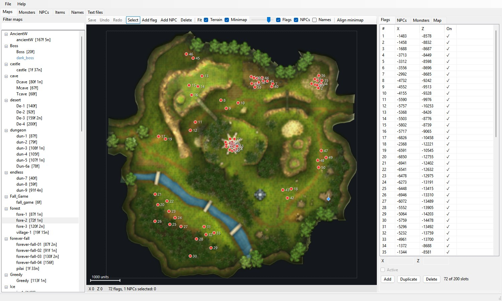

# PriTaTor Reborn

A server manager and map editor for Priston Tale. One exe, nothing to install.



## Using it

1. Copy `PriTaTorReborn.exe` into your game server folder, next to `GameServer` and `Field`.
2. Run it. The first run prepares every map on this server, with a loading window showing how far along it is.
   Later starts skip this, and only a map whose `.smd` changed gets prepared again.
3. Reload the server after saving: it only reads these files when it starts.

Before any file is overwritten, the old one is copied to `PriTaTor_Backups\<date and time>\`.

## Tabs

| Tab | What it edits |
|---|---|
| **Maps** | Monster flags and NPCs on the map: move, add, delete and turn. Each map's monster list and bosses. |
| **Monsters, NPCs, Items** | `GameServer\Monster`, `NPC` and `OpenItem` files, as labelled fields or raw text. |
| **NPCs > Shop** | What an NPC sells, picked by category and name, with no item codes to type. Also on the Maps tab: **Edit shop…**. |
| **Names** | The `.zhoon` files holding English names and dialogue. |
| **Text files** | Any text file in the server folder. |

## Map editor keys

| Action | Input |
|---|---|
| Select | Click. Ctrl+click adds to the selection. Drag empty ground to box-select. |
| Move | Drag a flag or NPC, or use the arrow keys (10 units, Shift for 100). |
| Turn an NPC | Drag the white handle (Shift snaps to 15°), or Q / E (5°, Shift for 45°). |
| Pan and zoom | Right or middle drag, mouse wheel. F fits the whole map. |
| Add | Add flag / Add NPC on the toolbar, or right-click the map. |
| Delete, duplicate | Del, Ctrl+D |
| Undo, redo, save | Ctrl+Z, Ctrl+Y, Ctrl+S |

## Names

Names come from each file's linked `.zhoon` file, such as `*E_NAME "Blacksmith Goden"`. The letter before `_NAME` is the
language and can be anything, so `*J_NAME`, `*B_NAME` and the rest all work. If a file has no linked name, its `*Name` line
is used instead.

## NPC shops

Each of the three sections (`*무기판매`, `*방어구판매`, `*잡화판매`) is a tab in the game's shop window, and any item can go on
any tab. Pick a category on the left, or search by name or code, and double-click to add. Saving only changes the codes you
changed. An item with no file on this server shows in red. The biggest tab on the test server holds 31 items, so the editor
warns past 32. That limit hasn't been confirmed in game.

## How maps line up

Nothing about map positions is built into the program. Each map's position comes from the terrain in its own `.smd`
file: the bounds of the vertices its faces use, in the game's world coordinates. Flags and NPCs are stored in those same
coordinates, so they line up by construction.

- **Terrain layer:** drawn from the `.smd` itself, so it's exact, and it's there even for maps with no minimap. Each picture
  is saved as a PNG in `PriTaTor\Terrain\`, in the same folders as `Field\`. They're safe to delete, and get redrawn.
- **Minimap layer:** `Field\map\*.tga` stretched to the map's bounds. This matches the old tool's hand calibrations
  to a median of 31 world units, about one pixel. Minimaps are hand-made art, so a few sit slightly off: **Align minimap**
  lets you nudge one by hand, which moves the picture only, never your flags.

A map is measured and drawn again automatically when its file changes. **File > Rebuild settings and terrain pictures**
forces it for every map.

## Moved maps

- **Every stage `.smd` under `Field` is picked up**, in any subfolder, including `old\forest\o_fore-1.smd`. A map doesn't
  need spawn files to be listed. They're created the first time you save something on it.
- **Moved copies are detected** by comparing vertices, which also works for older versions of a map where most of the
  geometry has changed. The **Map** tab shows the offset, and **Import** brings the flags, NPCs and monster list across
  with that offset already filled in.
- **If a map moved but its spawn files didn't**, the flags and NPCs show as off the map. **Shift** moves them all back.
- **The server's own map table is checked.** The server exe has a hardcoded list of maps. A map missing from it is shown
  in blue, with a warning on the Map tab, as the server may not load it even with spawn files.

## File formats

| File | Layout |
|---|---|
| `<map>.ase.spp` | 12-byte records: `int state, x, z` in whole world units. State 0 is off. Standard size is 200 slots. |
| `<map>.ase.spc` | 100 slots of 504 bytes, see `Core\SpawnFiles.cs`. Position is fixed point (× 256); facing is 4096 to a full turn. |
| `<map>.ase.spm`, `.inf`, `.npc`, `.txt`, `.zhoon` | CP949 text, `*KEY value` lines. |

Saving changes only the bytes you edited. Text files keep their original bytes, line endings and comments for every line
you didn't touch.

## Building

Needs the .NET 8 SDK. It targets .NET Framework 4.8, which comes with Windows 10 and 11.

```bash
build.cmd
```

The result is `release\PriTaTorReborn.exe`.

## Tests

`tests\PriTaTor.Tests` checks the file handling and `PriTaTorReborn.exe --uitest <folder>` drives the real window and saves
screenshots. Both edit files, so only point them at a copy of a server's `GameServer` folder:

```bash
PriTaTor.Tests.exe <copy of server> <Field folder>
```

## Credits

PriTaTor Reborn is a new program, written from scratch in C#, but it stands on years of earlier work.

- **Sumomo** created PriTaTor in 2008 and developed it through 1.x
  ([original thread](https://forum.ragezone.com/threads/pritator-new-npc-manager-items-monsters-maps.441209/)), then
  released [PriTaTor 2](https://forum.ragezone.com/threads/new-pritator.1123191/) with source in 2017. The idea of placing
  spawn flags on the map, and the meanings of the monster, item and NPC fields used here, come from Sumomo's work.
- **bobsobol** kept the 1.8 downloads and full source available on RaGEZONE and helped work out the game's Korean text
  encoding in the PriTaTor thread.
- **MysteryPT** made the map references that shipped with PriTaTor 2.

The map reading is based on the SMD work in the
[SMD to ASE Converter](https://github.com/sungam3d/Pristontale-SMD-to-ASE-Converter) project.
